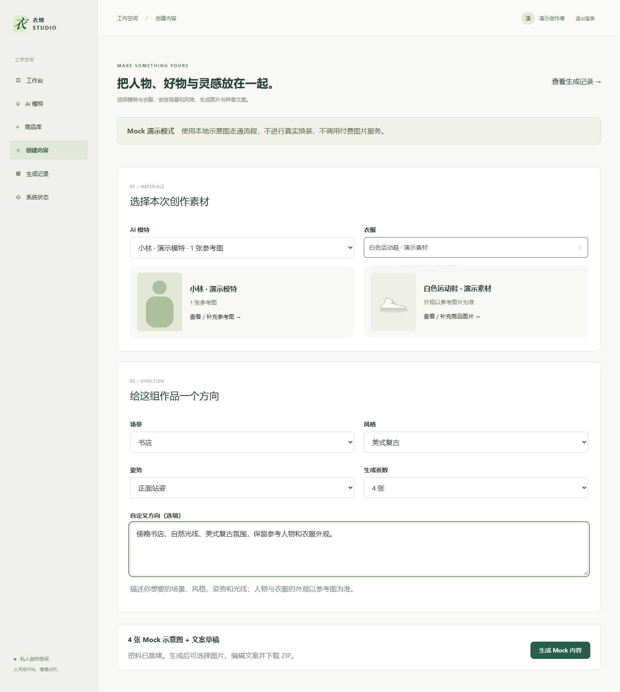
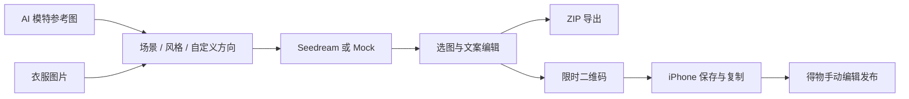
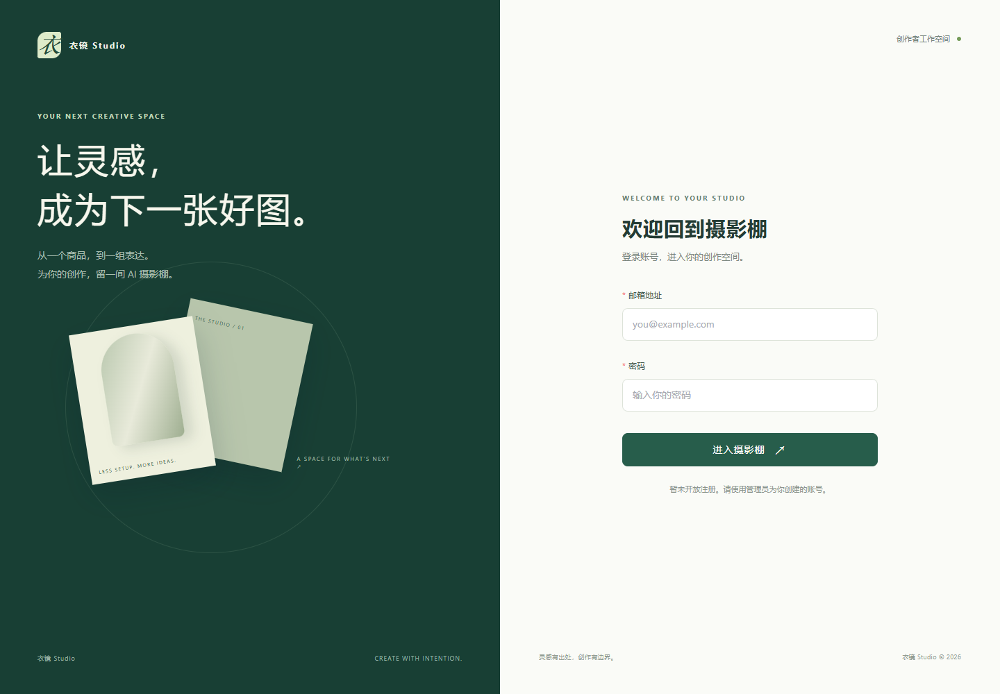
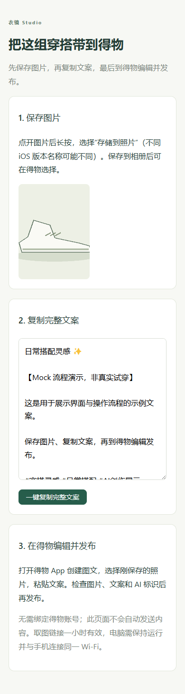

# 衣镜 Studio · Yijing Studio

**从一张人物参考图和一件衣服，完成穿搭图片、种草文案与手机发布素材的创作流程。**

个人作品集项目 · Vue 3 + TypeScript + FastAPI + PostgreSQL · 支持无密钥 Mock 演示



## 项目解决的问题

服装内容创作通常需要反复整理人物特征、衣服资料、场景提示词，再逐张下载图片、复制文案到手机。衣镜将这些步骤串成一个可编辑、可回溯的工作流：用参考图描述外观，用场景和自定义方向表达创意，最后把选中的作品和文案交付到手机。

## 主要功能

- **参考图驱动的人物档案**：只填写名字和性别，上传成年 AI 虚拟人物参考图，生成时参考人物外观。
- **图片驱动的衣服资料**：只填写衣服名称，上传图片后分析颜色、图案、版型；视觉观察与已确认资料分开保存。
- **穿搭创作**：带缩略图的衣服选择器，多种场景、风格、姿势与自定义方向，支持批量生成和部分失败补齐。
- **种草文案**：结合商品资料与生成图片，输出标题、分段搭配描述和话题标签，可编辑保存。
- **作品管理与导出**：勾选结果、预览原图、保存任务记录、下载 ZIP 素材包。
- **iPhone 发布助手**：电脑生成一小时有效的二维码，手机扫码取图和复制完整文案，再到得物手动编辑、发布；无需绑定得物账号。

## 设计与实现

| 层级 | 技术与职责 |
| --- | --- |
| 前端 | Vue 3、TypeScript、Vite、Pinia、Vue Router、Element Plus；桌面和手机响应式布局 |
| 后端 | FastAPI、Pydantic、SQLAlchemy；资料管理、任务执行、文案与素材导出 |
| 数据 | PostgreSQL、Alembic；任务快照、用户隔离与数据库迁移 |
| AI 接入 | Provider 抽象；Seedream 图片生成，Ark 豆包图片分析和文案；保留 Mock 演示模式 |
| 工程验证 | pytest、Playwright、Ruff、ESLint、TypeScript 生产构建 |

实现重点包括：提交幂等、执行租期、部分生成重试、文案编辑保护、失败回退、私有素材访问校验，以及可撤销的限时手机取图链接。二维码在本地生成，密钥只由后端读取。



## 界面预览

所有公开截图使用测试素材或 Mock 数据，不展示真实用户素材、账号凭据或付费生成效果。

| 登录入口 | 手机发布助手 |
| --- | --- |
|  |  |

## 本地运行

需要 Windows PowerShell、Docker Desktop（Linux containers）、Python 3.12+、Node.js 22.13+ 和 npm。

```powershell
git clone https://github.com/lanvh/yijing-studio.git
cd yijing-studio

python -m venv backend/.venv
& backend/.venv/Scripts/python.exe -m pip install -r backend/requirements.lock
npm --prefix frontend ci

powershell -ExecutionPolicy Bypass -File scripts/init-env.ps1
powershell -ExecutionPolicy Bypass -File scripts/start-local.ps1
powershell -ExecutionPolicy Bypass -File scripts/create-local-admin.ps1
```

打开 [本地工作台](http://localhost:5173)，使用本地 `.env` 中脚本生成的账号登录；API 文档为 [本地 Swagger](http://localhost:8000/docs)。不提供公开默认密码。

默认 `IMAGE_PROVIDER=mock`，不需要 API Key，即可演示创建资料、上传测试素材、生成示意图、编辑文案、导出及手机取图。Mock 不是真实 AI 换装。

真实服务可按 `.env.example` 配置：

```dotenv
IMAGE_PROVIDER=seedream
IMAGE_API_KEY=你的火山方舟密钥
IMAGE_API_BASE_URL=https://ark.cn-beijing.volces.com/api/v3
IMAGE_MODEL=doubao-seedream-5-0-pro-260628
LLM_PROVIDER=ark
LLM_MODEL=doubao-seed-2-1-lite-260915
LLM_API_BASE_URL=https://ark.cn-beijing.volces.com/api/v3
```

`LLM_API_KEY` 留空时复用 `IMAGE_API_KEY`。真实调用需要相应模型权限并按服务商规则计费。修改配置后重启服务；设置页检查配置，不验证余额或远端权限。

## 验证与项目边界

- 最近的后端全量回归为 235 项通过；补充跨账号用例后，手机取图专项 5 项通过。
- 生成页相关浏览器回归 9 项通过，覆盖选图、文案编辑、导出、缩略图选择和手机取图。
- 自动化验证使用 Mock 或 HTTP 模拟，不代表真实人物一致性、衣服还原度或实际 iPhone 系统菜单已完成验收。
- 当前展示源码与本地应用，没有公开在线演示站点；完整应用包含后端与数据库，不能直接作为 GitHub Pages 静态站点运行。
- 不会自动登录或发布到得物；最终内容由用户审核和发布。AI 图像、视觉观察与真实商品参数需区分。

## 进一步阅读

- [本地开发与历史实现记录](DEVELOPMENT.md)
- [架构设计](ARCHITECTURE.md) · [API 文档](API.md) · [数据库设计](DATABASE.md)
- [Seedream 接入记录](SEEDREAM_REPORT.md)
- [简化创作流程](SIMPLIFIED_WORKFLOW_REPORT.md)
- [iPhone 发布助手](MOBILE_PUBLISH_REPORT.md)

密钥、账号密码、数据库内容、上传图片、生成素材和本地工具不包含在公开仓库中。请勿提交 `.env`。
